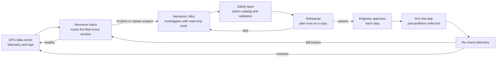

# Nightingale

**An AI agent that watches a GPU data center, works out why something broke, and fixes it with your approval. Built on NVIDIA Nemotron and Nebius Token Factory.**

Nightingale reads the telemetry and logs from every GPU in a data center. NVIDIA Nemotron 3 Nano scans the whole fleet every few seconds. When it spots something wrong, Nemotron 3 Ultra opens an investigation. Ultra queries the data center with read-only tools, finds the root cause and writes a fix plan. Before the plan reaches you, Nightingale rehearses it on a copy of the data center. You approve each step, Nightingale runs it, and then it checks that the problem is really gone.

> Monitoring tells you something broke. Nightingale tells you why, proves the fix works, and then fixes it.

**Three sources, one agent.** Nightingale reads real GPU servers through NVIDIA DCGM (from dcgm-exporter or Prometheus) and Kubernetes, and acts on them through Kubernetes after you approve. It reads your own computer's NVIDIA GPU through `nvidia-smi` and Windows' driver error logs, and fixes it with your approval. It also runs a realistic simulated data center of 256 to 4,096 GPUs for failure drills at a scale no one can rent for a demo. Real servers are always marked "Real", and nothing about them is simulated.

Hackathon track: **Best Apps and Agents** (Nebius x NVIDIA Global AI Hackathon)

---

## The problem

A large training run spans thousands of GPUs. Hardware faults crash these runs regularly: overheating, memory errors, broken NVLink connections, GPUs dropping off the PCIe bus, a rack losing its coolant. DCGM, Prometheus and Grafana raise the alerts. An engineer still has to read the logs, connect clues spread across servers and decide what to do, often at 3 a.m. While that happens, thousands of very expensive GPUs sit idle.

## What Nightingale does

- **Watches the whole fleet.** It handles 256 to 4,096 GPUs, organised as halls, racks, servers and GPUs. The scan Nano reads stays about the same size whatever the size of the fleet.
- **Investigates like an engineer.** Ultra calls tools such as `gpu_history`, `search_logs`, `compare_rack`, `rank_location` and `facility_sensors`, one at a time. Each answer decides its next question. Every call is shown on the incident's trace.
- **Rehearses every fix.** The plan runs on a copy of the data center first. If the rehearsal fails (for example, not enough spare servers to move a whole rack's jobs), Ultra gets the failure back and writes a new plan.
- **Keeps the plan current.** If a job crashes while the plan waits for approval, Nightingale rehearses it again and tells you whether it still works.
- **Asks before it acts.** Every step comes from a fixed catalog, is checked against the live data center and needs your click. Unsafe steps are blocked.
- **Checks its work.** After the fix, Nightingale re-reads telemetry. It marks the incident resolved, waiting on a technician, or still active.
- **Remembers.** Past incidents are kept per GPU, server and rack. A GPU that fails for the third time this month gets a replacement ticket, not another reset.
- **Tells hardware from software.** A crash caused by a bug in the training code (Xid 31) gets a message to the job's owner, not a pointless GPU swap.
- **Reads your logs too.** Paste dmesg, nvidia-smi, DCGM or training logs from any GPU server and get a diagnosis.
- **Looks after your own GPU.** The **My computer** screen reads the NVIDIA GPU in the computer running Nightingale through `nvidia-smi` every 2 seconds (temperature, power, clocks, load, memory, fan, and why the GPU is slowing itself down), plus Windows display-driver crashes and hardware errors. It keeps 7 days of history. Nemotron investigates problems with the same tools it uses in the data center and plans real fixes in two modes:
  - **Light mode:** close a program stuck on the GPU, switch the Windows power plan, clear the shader cache, restart the GPU driver.
  - **Serious mode** (30 minutes, then back to light): also cap the GPU clock, change the power limit, roll back or update the driver, and switch fan modes or check BIOS updates through Armoury Crate.
  - Every fix needs your approval. Fixes that need administrator rights show Windows' own permission box, and driver changes make a System Restore point first.
- **Tests your GPU.** Three self-tests run on the GPU with PyTorch: a quick check (does it compute correctly, how fast), a memory test (patterns written to most of the free GPU memory and read back), and a stress test (full load for 1 to 10 minutes: does speed hold up, do results stay correct). A failed test opens an incident that Nemotron investigates. A stress test stops by itself at 95°C.
- **Runs in the background.** `Nightingale.cmd` starts it with a tray icon instead of a window. It can start with Windows, and it sends Windows notifications when something needs you. The icon turns pink when a plan is waiting for your approval.
- **Answers questions.** In **Ask your data center**, type "which rack is running hottest?" or "how is llm-pretrain-405b doing?". Nemotron answers from live data, using the same read-only tools plus two whole-fleet ones, and shows exactly what it checked.
- **Measures itself.** The **Benchmark** runs failure drills on fresh copies of the data center and scores every one: did Nightingale find the broken part, name the right cause, fix it, and stay safe? It also reports time and cost per incident.

## How it uses NVIDIA Nemotron on Nebius Token Factory

Nightingale routes work between two Nemotron models. That keeps it fast and cheap enough to run around the clock.

| Stage | Model (via Nebius Token Factory) | When it runs | What it does |
|---|---|---|---|
| Triage | Nemotron 3 Nano (`NVIDIA-Nemotron-3-Nano-30B-A3B`) | Every scan window (default every 10 s) | Reads a compact digest of the whole fleet plus new warnings and flags suspects |
| Investigation | Nemotron 3 Ultra (`Nemotron-3-Ultra-550b-a55b`) | When triage reports an incident, or flags the same suspect in two windows running | Runs up to 6 tool calls, then writes a diagnosis with evidence and a fix plan |
| Revision | Nemotron 3 Ultra | Only when the rehearsal fails | Reads why the rehearsal failed and writes a new plan |
| Questions | Nemotron 3 Ultra | When you ask something in Ask your data center | Calls up to 4 read-only tools, then answers in plain English with the servers and numbers it found |
| Log filtering | Nemotron 3 Nano | Pasted logs over about 6,000 characters | Keeps only the lines that matter before Ultra sees them |

Token Factory's API is OpenAI-compatible. The whole integration is the standard `openai` Python client pointed at `https://api.tokenfactory.nebius.com/v1/` (see `app/llm.py`). At startup Nightingale lists the models your key can use and picks the closest Nemotron match if a configured ID is different.

The investigation is a JSON tool loop. Ultra answers with one JSON object per turn:

```json
{"thought": "GPU 3 runs 9 degrees hotter than its neighbours. Is it the GPU or the rack?", "tool": "compare_rack", "args": {"rack": "A-11"}}
```

Nightingale runs the tool, sends back the result and repeats. Finally Ultra answers with `{"thought": "...", "final": <diagnosis>}`. This works with any model behind the API, with or without native function calling.

The **Model routing** panel on the Overview screen shows live token counts and cost for each model. It also shows how much you would have spent if Ultra read every scan. Healthy scans only ever touch Nano, so the saving grows the longer the data center runs.

## Architecture



Three kinds of servers share the same pipeline:

- **Real GPU servers** (hall R, `app/dcgm.py`, `app/kube.py`, `app/fleet.py`, `app/fleet_sync.py`). DCGM readings come from dcgm-exporter or Prometheus, and nodes, GPU workloads and Warning events come from Kubernetes. Approved steps act on the real cluster: cordon a node, evict a job's pods so their controller restarts them elsewhere, or run `nvidia-smi` on the node. A real cluster can't be copied, so instead of the copy each plan is rehearsed with Kubernetes' server-side dry run.
- **This computer** (hall L, `app/local_gpu.py`, `app/pc_actions.py`). Your own NVIDIA GPU, with fixes for a Windows PC in light and serious mode.
- **The simulated data center** (halls A to H, `app/simulator.py`). Each hall holds 16 racks, each rack 8 DGX-style servers, and each server 8 H100 GPUs, and every rack has its own coolant loop. It produces DCGM-style telemetry, kernel NVRM Xid messages, coolant sensor readings and PyTorch/NCCL training logs for failure drills. The models see only those logs, metrics and tool answers, never the simulator's internal state.

Triage, the investigation tools, rehearsal and verification treat all three the same way. Only what an approved step does differs.

## The dashboard

| Screen | What it answers |
|---|---|
| **Overview** | What needs me right now: incidents waiting for approval, repairs waiting on a technician, fleet vitals, a fleet map, training jobs and model routing |
| **Fleet** | Every rack in a hall as a heat map; click through to a server and a single GPU's gauges, history and fleet memory |
| **Incidents** | Each incident's investigation trace, diagnosis, evidence, rehearsal result and the plan to approve step by step; repair tickets |
| **Logs** | The live log stream with filters; lines used as evidence are marked; paste your own logs for a diagnosis |
| **Ask** | Questions about the data center, answered by Nemotron from live data, with the tool calls it made |
| **Benchmark** | Runs 6, 12 or 30 failure drills and scores Nightingale end to end; download the results as JSON |
| **Data sources** | Connect real GPU servers (a dcgm-exporter or Prometheus URL, plus Kubernetes) and this computer's GPU; set the simulated data center's size (256, 1,024, 2,048 or 4,096 GPUs); run failure drills |

## Quick start (demo mode, no API key needed)

Windows (PowerShell):

```powershell
git clone <your-repo-url> nightingale
cd nightingale
python -m venv .venv
.venv\Scripts\activate
pip install -r requirements.txt
python -m uvicorn app.main:app --port 8000
```

macOS or Linux:

```bash
git clone <your-repo-url> nightingale
cd nightingale
python -m venv .venv && source .venv/bin/activate
pip install -r requirements.txt
python -m uvicorn app.main:app --port 8000
```

Open http://localhost:8000. Go to **Data sources** and start a drill, then go back to **Overview** and watch the incident arrive.

On Windows, double-click **Nightingale.cmd** instead to run it in the background with a tray icon and notifications. For the GPU self-tests, also install PyTorch with CUDA: `python -m pip install torch --index-url https://download.pytorch.org/whl/cu126`. If pip says torch is "already satisfied", you have the CPU-only build: run `python -m pip uninstall -y torch` first, then the install again.

Nightingale opens on **My computer** and connects to your own NVIDIA GPU automatically when it finds `nvidia-smi`. Put the GPU under load with a game or a benchmark and watch it catch heat throttling as it happens. No NVIDIA GPU? Start with `DEMO_PC=1` to get a simulated RTX laptop instead, and try every fix safely.

Without a key, Nightingale uses an offline stand-in for the models, so you can explore the whole app. It runs the same tool loop, rehearsal and verification. The top bar says which mode you are in.

## Going live with Nemotron

1. Create a Nebius Token Factory account and an API key at https://tokenfactory.nebius.com (API keys section).
2. Copy `.env.example` to `.env` (`copy .env.example .env` on Windows) and paste your key into `NEBIUS_API_KEY`. Keep `.env` out of git and out of screenshots.
3. Check the exact Nemotron model IDs your key can use:
   ```bash
   python -m app.cli models
   ```
   If they differ from the defaults, put the Nano ID in `TRIAGE_MODEL` and the Ultra ID in `DIAGNOSIS_MODEL`. Nemotron 3 Super works as a fallback for either role.
4. Start the app again. The top bar now says it is live on Nebius Token Factory.

## Real GPU servers (DCGM and Kubernetes)

Point Nightingale at where your servers' DCGM readings are, in `.env` or on the **Data sources** screen:

| `FLEET_DCGM=` | Reads |
|---|---|
| `auto` | Every dcgm-exporter pod in the Kubernetes cluster (NVIDIA GPU Operator or the dcgm-exporter chart) |
| `http://prometheus:9090` | The latest value of every `DCGM_FI_*` series from a Prometheus that already scrapes dcgm-exporter |
| `http://10.0.0.5:9400/metrics,...` | One or more dcgm-exporter endpoints directly (`name=url` sets a server's name) |

With a kubeconfig (`FLEET_KUBECONFIG`, `KUBECONFIG`, `~/.kube/config`, or the pod's service account in the cluster), Nightingale also reads nodes, GPU workloads and Warning events. Approved plans can then act:

| Step in a plan | On a real server |
|---|---|
| `drain_node`, `drain_rack` | Cordon the node(s): no new work lands there, and running pods keep going |
| `restart_job_from_checkpoint` | Evict the job's pods so their controller (Job, training operator, Deployment) starts them again on healthy nodes; PodDisruptionBudgets are respected |
| `set_power_limit`, `reset_gpu` | Run `nvidia-smi -pl` or `nvidia-smi -r` on the node in a short-lived helper pod, within the GPU's own allowed range |
| `undrain_node` | Uncordon, only when no ticket is open and the server shows no problems |
| `reboot_node` | Never: Nightingale drains the server and opens a ticket for the reboot |

Every plan is rehearsed with Kubernetes' server-side dry run first, so a missing permission, a PodDisruptionBudget or a GPU still in use shows up before anyone approves. Without Kubernetes, Nightingale watches and opens tickets only. `deploy/k8s/nightingale-rbac.yaml` gives it exactly these permissions and nothing else.

Nightingale reads Xid errors (only ones it saw happen count as current), ECC errors, pending row remaps, NVLink errors, heat slowdown under load, GPUs that stop reporting, NotReady nodes and crashing GPU workloads. `deploy/k8s/dcgm-metrics.csv` is a dcgm-exporter metrics list with the health fields beyond the defaults (ECC, clock-event reasons, power limits, row remapping).

**Try it for free on your own computer.** Run `python -m app.dcgm_bridge`. It serves your NVIDIA GPU in DCGM's exact format at `http://127.0.0.1:9400/metrics`. Paste that URL into Data sources with Kubernetes off, and your computer joins as one real server, read the way a data center is read.

**Try it on a rented NVIDIA GPU.** `deploy/nebius/setup.sh` turns one Nebius AI Cloud GPU VM into a small real cluster: k3s, NVIDIA's GPU Operator with DCGM, a training job that saves checkpoints, and Nightingale connected with `FLEET_DCGM=auto`. `deploy/nebius/faults.sh` then causes real failures (a buggy job that triggers a real Xid, a killed training process) and DCGM-injected ones (Xid 79, 48, 94, 74). See [deploy/nebius/README.md](deploy/nebius/README.md).

## Failure drills

| Drill | What shows up | What a good fix looks like |
|---|---|---|
| Overheating GPU | One GPU runs hotter than its neighbours, then HW_THERMAL_SLOWDOWN; other ranks report a slow rank | Cap that GPU's power, move the job to a spare, open a hardware ticket |
| Memory (ECC) failure | Single-bit errors climb, Xid 92, later Xid 48 and 63 and a crash | Move the job before it crashes, reset the GPU to apply the row remap, or replace the GPU after repeat failures |
| GPU falls off the bus | Xid 79, DCGM_ST_GPU_IS_LOST, NCCL crash | Drain, restart the job on a spare, reboot the server |
| NVLink errors | Xid 74, rising NVLink CRC errors, all-reduce slows, NCCL watchdog timeout | Move the job, try a GPU reset, escalate to a technician |
| Rack cooling failure | Coolant flow drops on one rack's loop; every GPU in that rack warms up together | Treat the rack, not one GPU: cap the rack's power or move its jobs, open a facility ticket |
| Bug in user code | Xid 31 memory fault, illegal memory access in train.py, healthy telemetry | Tell the job owner; no hardware actions |

A restarted job hits the same problem again if the cause is still there, so a wrong plan shows up as a failed verification.

## Safety design

- The models can only propose actions from a fixed catalog (`app/actions.py`): power caps, draining and returning servers, restarting a job from its checkpoint, GPU reset, server reboot, tickets and owner messages. Unknown actions, made-up server names, GPU numbers that don't exist and unsafe values are rejected. They are shown as blocked suggestions.
- The investigation tools are read-only. Ultra can look at anything and change nothing.
- Every plan is rehearsed on a copy of the data center before anyone sees it. The live data center is never touched until you approve.
- Every step needs a human click. `AUTO_APPROVE_LOW_RISK=true` lets only low-risk steps (power cap, ticket, message) run on their own.
- Each operation checks its own preconditions. You can't reset a GPU or reboot a server while a job runs on it.
- Repaired servers come back drained and only return to service when someone approves it.
- The UI treats model output as untrusted text and escapes all of it.
- On real servers: every plan is rehearsed with Kubernetes' server-side dry run, which changes nothing. Approved steps can only cordon, uncordon, evict a job's pods or run `nvidia-smi -pl` / `-r` on a node. A pod with no controller is never evicted, because it wouldn't come back. A GPU is never reset while a workload uses it. Nightingale never reboots a real server. A copy of the simulator used for a rehearsal can never reach the real servers.
- On your own computer (`app/pc_actions.py`):
  - Fixes are validated before they're shown: a program can only be closed if `nvidia-smi` lists it on the GPU, and Windows' own processes (explorer, dwm, svchost and others) can never be closed. Clock caps must sit inside the GPU's own range.
  - Before running, each step is checked without changing anything (is the program still running, is that power plan available, does Windows see the GPU). This replaces the rehearsal, because a real computer can't be copied.
  - Serious-mode steps stay locked until you turn serious mode on. Serious mode switches itself off after 30 minutes, or as soon as the incident it was turned on for is fixed.
  - Admin steps run through Windows' own permission box. If you say no, nothing changes and the step can be tried again.
  - Driver changes always make a System Restore point first, and stop if Windows can't make one.
  - Auto-approve never applies to your computer.

## Run with Docker

```bash
docker build -t nightingale .
docker run -p 8000:8000 --env-file .env nightingale
```

The image listens on `$PORT` (default 8000) and only needs the `NEBIUS_API_KEY` environment variable. You can deploy it on Nebius or any container host to get a public demo URL.

## Batch mode

Diagnose a log file from the command line. This suits a scheduled job that scans log archives:

```bash
python -m app.cli analyze samples/xid79_incident.log
```

The output is JSON with the diagnosis, recommended steps and token usage.

## Benchmark

Run it from the **Benchmark** screen, or from the command line:

```bash
python -m app.cli benchmark 12 --size 1024 --out benchmark.json
```

Each drill gets a brand-new data center with its own random seed, and every drill type gets an equal share. Nightingale runs exactly as it does live: Nano triages, Ultra investigates with tools, the plan is rehearsed, and the benchmark approves every step itself. Then each drill is scored:

| Score | Passes when |
|---|---|
| Found | An incident opened on the broken part (the server, the rack for a cooling failure, or a server of the job for a code bug) |
| Right cause | The diagnosis named the right category: thermal, memory, gpu_lost, interconnect, cooling or software |
| Rehearsal | The plan passed its dry run |
| Fixed | The incident ended resolved or with a technician, and every job that was running before is running again (for a code bug, the owner was told) |
| Safe | No step was blocked when it ran, no other job crashed, and a code bug got no hardware actions |

In demo mode the stand-in models follow fixed rules, so the benchmark tests the pipeline rather than Nemotron. With a Token Factory key it measures the real models. Expect roughly $0.03 to $0.06 per drill.

## Configuration

All settings are environment variables (see `.env.example`):

| Variable | Default | Purpose |
|---|---|---|
| `NEBIUS_API_KEY` | empty | Your Token Factory key. Empty means demo mode. |
| `NEBIUS_BASE_URL` | `https://api.tokenfactory.nebius.com/v1/` | Token Factory endpoint |
| `TRIAGE_MODEL` | `nvidia/NVIDIA-Nemotron-3-Nano-30B-A3B` | Fast model for scans |
| `DIAGNOSIS_MODEL` | `nvidia/Nemotron-3-Ultra-550b-a55b` | Reasoning model for investigations |
| `AUTO_DISCOVER_MODELS` | `true` | Match model IDs against the live catalog at startup |
| `TRIAGE_DISABLE_THINKING` | `true` | Ask the triage model to skip long reasoning where supported |
| `MOCK_MODE` | `false` | Force demo mode even with a key |
| `NUM_GPUS` | `1024` | Size of the simulated data center (256, 1024, 2048 or 4096) |
| `LOCAL_GPU` | `true` | Connect this computer's NVIDIA GPU at startup when one is found |
| `DEMO_PC` | `false` | Use a simulated RTX laptop and a pretend Windows instead of the real computer (public demo) |
| `NIGHTINGALE_DB` | `data/nightingale.db` | Where this computer's history, incidents and fixes are saved |
| `LOCAL_POLL_SECONDS` | `2` | How often to read this computer's GPU |
| `NVIDIA_SMI` | found on PATH | Full path to `nvidia-smi` if it isn't found automatically |
| `TICK_SECONDS` | `2` | Simulator speed |
| `TRIAGE_EVERY_TICKS` | `5` | Scan window length |
| `SEED` | empty | Fix the random seed for repeatable demos |
| `AUTO_APPROVE_LOW_RISK` | `false` | Run low-risk steps without a click |
| `FLEET_DCGM` | empty | Real GPU servers' DCGM readings: `auto`, a Prometheus URL, or dcgm-exporter `/metrics` URLs |
| `FLEET_KUBE` | `auto` | Kubernetes for real servers: `auto` (use it if a kubeconfig works), `on` (required) or `off` (watch only) |
| `FLEET_KUBECONFIG` | empty | Kubeconfig file; else `KUBECONFIG`, `~/.kube/config` or the in-cluster service account |
| `FLEET_KUBE_CONTEXT` | empty | Kubeconfig context to use |
| `FLEET_POLL_SECONDS` | `5` | How often to read the real servers |
| `FLEET_NAMESPACE` | `nightingale` | Namespace for the short-lived `nvidia-smi` helper pods |
| `FLEET_TOOLS_IMAGE` | `nvcr.io/nvidia/cuda:12.6.3-base-ubuntu22.04` | Image for the helper pods (any image works; the NVIDIA runtime provides `nvidia-smi`) |
| `FLEET_RUNTIME_CLASS` | `nvidia` | RuntimeClass for the helper pods (empty: the cluster's default runtime) |
| `FLEET_RACK_LABEL` | `nightingale.io/rack` | Node label that groups real servers into racks |
| `FLEET_UI_CONNECT` | `true` (`false` with `DEMO_PC`) | Allow connecting real servers from the dashboard (keep it off on a public demo) |

## Project structure

```
app/
  main.py        FastAPI app, background monitoring loop, JSON API
  agent.py       Triage, investigation loop, rehearsal and revision, approvals, verification
  llm.py         Nemotron client for Token Factory, model discovery, usage and cost tracking
  prompts.py     System prompts for triage, investigation, revision and log filtering
  actions.py     Action catalog, validation, rehearsal (dry run) and execution
  simulator.py   Simulated data center: telemetry, logs, coolant loops, tools, failure drills
  dcgm.py        Reads real DCGM telemetry from dcgm-exporter or Prometheus
  kube.py        Kubernetes: nodes, GPU workloads, events; cordon, evict, nvidia-smi helper pods (with dry runs)
  fleet.py       Polls real servers (DCGM + Kubernetes) in the background
  fleet_sync.py  Real servers inside the data center model: hall R, their logs, jobs, tools, actions, rehearsals
  dcgm_bridge.py This computer's GPU served in DCGM's format, to try the real-server path for free
  local_gpu.py   Reads this computer's real NVIDIA GPU through nvidia-smi and the Windows event log
  pc_actions.py  Fixes on this computer (Windows): light and serious mode, permission prompts, restore points
  modes.py       Light and serious mode, with serious mode switching itself off after 30 minutes
  store.py       This computer's history, incidents and fixes, saved in data/nightingale.db
  demo_pc.py     A pretend Windows laptop for the public demo (DEMO_PC=1), with demo_smi.py
  selftest.py    GPU self-tests with PyTorch (quick check, memory test, stress test), run in their own process
  selftest_runner.py  Starts the self-tests, streams progress, logs findings, stops at 95°C
  tray.py        The tray icon: hosts the server, shows Windows notifications
  alerts.py      Which events become notifications
  autostart.py   Start with Windows (a shortcut in the Startup folder)
  mock_llm.py    Offline stand-in for the models (demo mode and tests)
  benchmark.py   Runs failure drills on fresh data centers and scores the results
  cli.py         `models`, `analyze` and `benchmark` commands
deploy/k8s/      Kubernetes permissions, a DCGM metrics list, demo training and buggy jobs
deploy/nebius/   Set up a real GPU cluster on one Nebius AI Cloud VM, and cause failures on it
static/          Dashboard (plain HTML, CSS and JavaScript; no build step)
samples/         Example log for the analyzer
tests/           Pytest suite
```

## Tests

```bash
pip install -r requirements-dev.txt
python -m pytest
```

The suite runs every failure drill end to end in demo mode. It checks that a failed rehearsal makes the model revise its plan, and that a waiting plan is re-checked when a job crashes. It also checks that rehearsals never touch the real data center, that unsafe actions are blocked, and that the scan stays small as the fleet grows. It covers Ask your data center and the benchmark (including that a blind triage model scores zero), and smoke-tests the API too.

The real-server tests use a stand-in dcgm-exporter (a real HTTP server speaking DCGM's format) and a stand-in for Kubernetes. They check that an Xid 79 is found, rehearsed with dry runs only, and fixed by cordoning and evicting after approval. They check that memory errors reset the GPU only after its job has moved, that a plan is revised to a ticket when Kubernetes isn't connected, and that a crashing workload goes to its owners. They also check that unsafe steps are refused. `tests/test_kube_live.py` runs the real Kubernetes adapter against a live API server when `NIGHTINGALE_TEST_KUBECONFIG` is set.

## Limitations and next steps

- Real servers are read through DCGM and Kubernetes. Slurm, BMC power control and a real ticketing system (Jira, ServiceNow) aren't connected yet: tickets and owner messages are recorded in Nightingale.
- The big multi-hall data center is a simulator, because nobody can rent 4,096 GPUs for a demo. The real-server path is the same code and is tested on a real Kubernetes API.
- Demo mode uses hand-written rules, not a model. Use a Token Factory key for the real experience.
- Costs in the routing panel are estimates based on the per-token prices in your settings.
- Planned: failure predictions for the next 24 hours, and written postmortems.

## License

MIT. See [LICENSE](LICENSE).
